<!-- Auto-generated by tools/generate_diagrams.py from config/config-a.yaml. Do not hand-edit. -->

# PocketQube reference (SomaiyaSat-derived) — State Diagram

```mermaid
stateDiagram-v2
    [*] --> S_01
    state "STOWED" as S_01
    state "RF_INHIBIT" as S_02
    state "DEPLOY_CONFIRM_PENDING" as S_03
    state "DEPLOYED_CONFIRMED" as S_04
    state "COMMISSIONING" as S_05
    state "COMMS_TTC" as S_06
    state "COMMS_SSTV" as S_07
    state "COMMS_VOICE" as S_08
    state "COMMS_IDLE" as S_09
    state "SAFE_MODE" as S_10
    state "(any state)" as ANY
    state "(restored from persistence)" as RELOAD
    S_01 --> S_02 : T-01 / SEPARATION_DETECTED
    S_02 --> S_03 : T-02 / RF_INHIBIT_TIMER_EXPIRED
    S_03 --> S_03 : T-03 / DEPLOY_CONFIRM_PATH_A
    S_03 --> S_04 : T-04 / DEPLOY_CONFIRM_PATH_A
    S_03 --> S_03 : T-05 / DEPLOY_CONFIRM_PATH_B
    S_03 --> S_04 : T-06 / DEPLOY_CONFIRM_PATH_B
    S_04 --> S_05 : T-07 / ENTER_COMMISSIONING
    S_05 --> S_06 : T-08 / COMMISSIONING_COMPLETE
    S_06 --> S_06 : T-09 / SCHEDULER_SELECT_TTC
    S_07 --> S_06 : T-09 / SCHEDULER_SELECT_TTC
    S_08 --> S_06 : T-09 / SCHEDULER_SELECT_TTC
    S_09 --> S_06 : T-09 / SCHEDULER_SELECT_TTC
    S_06 --> S_07 : T-10 / SCHEDULER_SELECT_SSTV
    S_07 --> S_07 : T-10 / SCHEDULER_SELECT_SSTV
    S_08 --> S_07 : T-10 / SCHEDULER_SELECT_SSTV
    S_09 --> S_07 : T-10 / SCHEDULER_SELECT_SSTV
    S_06 --> S_08 : T-11 / SCHEDULER_SELECT_VOICE
    S_07 --> S_08 : T-11 / SCHEDULER_SELECT_VOICE
    S_08 --> S_08 : T-11 / SCHEDULER_SELECT_VOICE
    S_09 --> S_08 : T-11 / SCHEDULER_SELECT_VOICE
    S_06 --> S_09 : T-12 / SCHEDULER_SELECT_IDLE
    S_07 --> S_09 : T-12 / SCHEDULER_SELECT_IDLE
    S_08 --> S_09 : T-12 / SCHEDULER_SELECT_IDLE
    S_09 --> S_09 : T-12 / SCHEDULER_SELECT_IDLE
    S_06 --> S_09 : T-13 / PASS_END
    S_07 --> S_09 : T-13 / PASS_END
    S_08 --> S_09 : T-13 / PASS_END
    S_09 --> S_09 : T-13 / PASS_END
    S_05 --> S_10 : T-14 / FAULT_DETECTED
    S_06 --> S_10 : T-14 / FAULT_DETECTED
    S_07 --> S_10 : T-14 / FAULT_DETECTED
    S_08 --> S_10 : T-14 / FAULT_DETECTED
    S_09 --> S_10 : T-14 / FAULT_DETECTED
    S_05 --> S_10 : T-15 / POWER_LOW
    S_06 --> S_10 : T-15 / POWER_LOW
    S_07 --> S_10 : T-15 / POWER_LOW
    S_08 --> S_10 : T-15 / POWER_LOW
    S_09 --> S_10 : T-15 / POWER_LOW
    S_05 --> S_10 : T-16 / WATCHDOG_TIMEOUT
    S_06 --> S_10 : T-16 / WATCHDOG_TIMEOUT
    S_07 --> S_10 : T-16 / WATCHDOG_TIMEOUT
    S_08 --> S_10 : T-16 / WATCHDOG_TIMEOUT
    S_09 --> S_10 : T-16 / WATCHDOG_TIMEOUT
    S_03 --> S_10 : T-17 / GROUND_SAFE_MODE_CMD
    S_04 --> S_10 : T-17 / GROUND_SAFE_MODE_CMD
    S_05 --> S_10 : T-17 / GROUND_SAFE_MODE_CMD
    S_06 --> S_10 : T-17 / GROUND_SAFE_MODE_CMD
    S_07 --> S_10 : T-17 / GROUND_SAFE_MODE_CMD
    S_08 --> S_10 : T-17 / GROUND_SAFE_MODE_CMD
    S_09 --> S_10 : T-17 / GROUND_SAFE_MODE_CMD
    S_10 --> S_10 : T-17 / GROUND_SAFE_MODE_CMD
    S_10 --> S_05 : T-18 / AUTONOMOUS_RECOVERY_CONDITIONS_MET
    S_10 --> S_05 : T-21 / GROUND_OVERRIDE_EXIT_SAFE
    S_10 --> S_03 : T-25 / AUTONOMOUS_RECOVERY_CONDITIONS_MET
    S_10 --> S_03 : T-26 / GROUND_OVERRIDE_EXIT_SAFE
    ANY --> RELOAD : T-22 / RESET
    ANY --> ANY : T-23 / UPLINK_CMD_GENERIC
    S_03 --> RELOAD : T-24 / COMMS_LOSS_TIMEOUT
    S_04 --> RELOAD : T-24 / COMMS_LOSS_TIMEOUT
    S_05 --> RELOAD : T-24 / COMMS_LOSS_TIMEOUT
    S_06 --> RELOAD : T-24 / COMMS_LOSS_TIMEOUT
    S_07 --> RELOAD : T-24 / COMMS_LOSS_TIMEOUT
    S_08 --> RELOAD : T-24 / COMMS_LOSS_TIMEOUT
    S_09 --> RELOAD : T-24 / COMMS_LOSS_TIMEOUT
    S_10 --> RELOAD : T-24 / COMMS_LOSS_TIMEOUT
```

## Transition legend

| ID | From | Event | Guard | To | Actions | Requirements |
|---|---|---|---|---|---|---|
| T-01 | S-01 | E-01 (SEPARATION_DETECTED) | — | S-02 | start_rf_inhibit_timer | R-01 |
| T-02 | S-02 | E-02 (RF_INHIBIT_TIMER_EXPIRED) | elapsed(rf_inhibit_timer) >= P-010 | S-03 | enable_rf, start_ground_contact_timer | R-02 |
| T-03 | S-03 | E-03 (DEPLOY_CONFIRM_PATH_A) | context.path_b_confirmed == false | S-03 | set context.path_a_confirmed = true | R-03, R-07 |
| T-04 | S-03 | E-03 (DEPLOY_CONFIRM_PATH_A) | context.path_b_confirmed == true | S-04 | set context.path_a_confirmed = true, set_deployment_confirmed_latch | R-03, R-04, R-07 |
| T-05 | S-03 | E-04 (DEPLOY_CONFIRM_PATH_B) | context.path_a_confirmed == false | S-03 | set context.path_b_confirmed = true | R-03, R-07 |
| T-06 | S-03 | E-04 (DEPLOY_CONFIRM_PATH_B) | context.path_a_confirmed == true | S-04 | set context.path_b_confirmed = true, set_deployment_confirmed_latch | R-03, R-04, R-07 |
| T-07 | S-04 | E-19 (ENTER_COMMISSIONING) | — | S-05 | — | R-05 |
| T-08 | S-05 | E-05 (COMMISSIONING_COMPLETE) | — | S-06 | begin_ttc_downlink | R-06 |
| T-09 | S-06, S-07, S-08, S-09 | E-06 (SCHEDULER_SELECT_TTC) | — | S-06 | switch_ttc_downlink, log_mode_change | R-11, R-13, R-17 |
| T-10 | S-06, S-07, S-08, S-09 | E-07 (SCHEDULER_SELECT_SSTV) | — | S-07 | switch_sstv_downlink, log_mode_change | R-11, R-13 |
| T-11 | S-06, S-07, S-08, S-09 | E-08 (SCHEDULER_SELECT_VOICE) | — | S-08 | switch_voice_downlink, log_mode_change | R-11, R-13 |
| T-12 | S-06, S-07, S-08, S-09 | E-09 (SCHEDULER_SELECT_IDLE) | — | S-09 | end_downlink, log_mode_change | R-11, R-13, R-18 |
| T-13 | S-06, S-07, S-08, S-09 | E-10 (PASS_END) | elevation < P-015 | S-09 | end_downlink, log_pass_end | R-12 |
| T-14 | S-05, S-06, S-07, S-08, S-09 | E-11 (FAULT_DETECTED) | fault_count >= P-019 | S-10 | suspend_non_ttc_downlink, log_rationale | R-21, R-31 |
| T-15 | S-05, S-06, S-07, S-08, S-09 | E-12 (POWER_LOW) | battery_soc <= P-013 | S-10 | suspend_non_ttc_downlink, log_rationale | R-21, R-25, R-31 |
| T-16 | S-05, S-06, S-07, S-08, S-09 | E-17 (WATCHDOG_TIMEOUT) | — | S-10 | suspend_non_ttc_downlink, log_rationale | R-21, R-31 |
| T-17 | S-03, S-04, S-05, S-06, S-07, S-08, S-09, S-10 | E-13 (GROUND_SAFE_MODE_CMD) | — | S-10 | suspend_non_ttc_downlink, log_rationale, start_ground_contact_timer | R-22, R-31 |
| T-18 | S-10 | E-15 (AUTONOMOUS_RECOVERY_CONDITIONS_MET) | context.deployment_confirmed == true | S-05 | resume_nominal_rotation, log_rationale | R-05, R-23, R-25, R-31 |
| T-21 | S-10 | E-14 (GROUND_OVERRIDE_EXIT_SAFE) | context.deployment_confirmed == true | S-05 | resume_nominal_rotation, log_rationale, start_ground_contact_timer | R-05, R-24, R-31 |
| T-25 | S-10 | E-15 (AUTONOMOUS_RECOVERY_CONDITIONS_MET) | context.deployment_confirmed == false | S-03 | resume_deployment_confirmation, log_rationale | R-05, R-23, R-31 |
| T-26 | S-10 | E-14 (GROUND_OVERRIDE_EXIT_SAFE) | context.deployment_confirmed == false | S-03 | resume_deployment_confirmation, log_rationale, start_ground_contact_timer | R-05, R-24, R-31 |
| T-22 | * | E-16 (RESET) | — | reload_from_persistence | reload_from_nvm, start_ground_contact_timer | R-04, R-27, R-28, R-29 |
| T-23 | * | E-18 (UPLINK_CMD_GENERIC) | — | (no-op) | log_command_received, start_ground_contact_timer | R-31, R-33 |
| T-24 | S-03, S-04, S-05, S-06, S-07, S-08, S-09, S-10 | E-20 (COMMS_LOSS_TIMEOUT) | elapsed(ground_contact_timer) >= P-025 | reload_from_persistence | reload_from_nvm, start_ground_contact_timer | R-34 |
