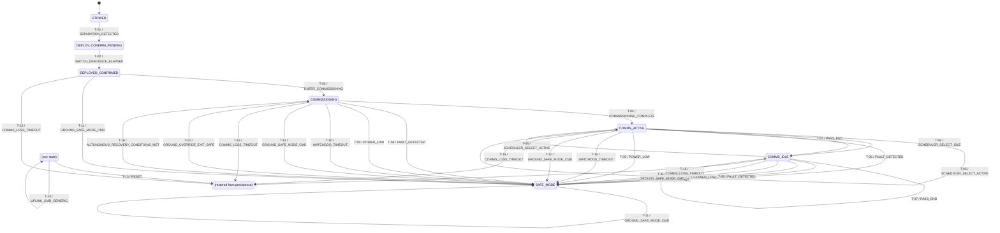

<!-- Auto-generated by tools/generate_diagrams.py from config/config-c.yaml. Do not hand-edit. -->

# Hybrid: single-path deployment, autonomous-permitted recovery — State Diagram

## Transition legend

| ID | From | Event | Guard | To | Actions | Requirements |
|---|---|---|---|---|---|---|
| T-01 | S-01 | E-01 (SEPARATION_DETECTED) | — | S-02 | start_switch_debounce_timer | RC-01 |
| T-02 | S-02 | E-14 (SWITCH_DEBOUNCE_ELAPSED) | elapsed(switch_debounce_timer) >= PC-002 | S-03 | set_deployment_confirmed_latch, enable_rf, start_ground_contact_timer | RC-01, RC-02 |
| T-03 | S-03 | E-02 (ENTER_COMMISSIONING) | — | S-04 | — | RC-03 |
| T-04 | S-04 | E-03 (COMMISSIONING_COMPLETE) | — | S-05 | begin_downlink | RC-04 |
| T-05 | S-05, S-06 | E-04 (SCHEDULER_SELECT_ACTIVE) | — | S-05 | begin_or_continue_downlink, log_mode_change | RC-05 |
| T-06 | S-05, S-06 | E-05 (SCHEDULER_SELECT_IDLE) | — | S-06 | end_downlink, log_mode_change | RC-05 |
| T-07 | S-05, S-06 | E-06 (PASS_END) | elevation < PC-006 | S-06 | end_downlink, log_pass_end | RC-06 |
| T-08 | S-04, S-05, S-06 | E-07 (FAULT_DETECTED) | fault_count >= PC-005 | S-07 | suspend_downlink, log_rationale | RC-07, RC-11 |
| T-09 | S-04, S-05, S-06 | E-08 (POWER_LOW) | battery_soc <= PC-003 | S-07 | suspend_downlink, log_rationale | RC-07, RC-11 |
| T-10 | S-04, S-05, S-06 | E-09 (WATCHDOG_TIMEOUT) | — | S-07 | suspend_downlink, log_rationale | RC-07, RC-11 |
| T-11 | S-03, S-04, S-05, S-06, S-07 | E-10 (GROUND_SAFE_MODE_CMD) | — | S-07 | suspend_downlink, log_rationale, start_ground_contact_timer | RC-08, RC-11 |
| T-12 | S-07 | E-11 (GROUND_OVERRIDE_EXIT_SAFE) | — | S-04 | resume_nominal_rotation, log_rationale, start_ground_contact_timer | RC-09, RC-11 |
| T-13 | * | E-12 (RESET) | — | reload_from_persistence | reload_from_nvm, start_ground_contact_timer | RC-02, RC-10 |
| T-14 | * | E-13 (UPLINK_CMD_GENERIC) | — | (no-op) | log_command_received, start_ground_contact_timer | RC-11 |
| T-15 | S-03, S-04, S-05, S-06 | E-15 (COMMS_LOSS_TIMEOUT) | elapsed(ground_contact_timer) >= PC-011 | reload_from_persistence | reload_from_nvm, start_ground_contact_timer | RC-12 |
| T-16 | S-07 | E-16 (AUTONOMOUS_RECOVERY_CONDITIONS_MET) | battery_soc >= PC-012 | S-04 | resume_nominal_rotation, log_rationale | RC-13 |
